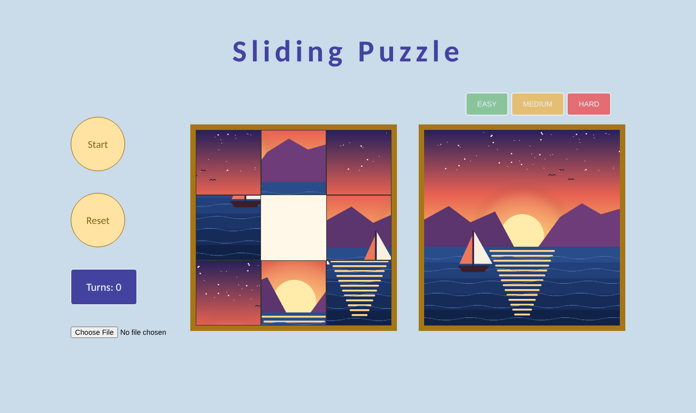
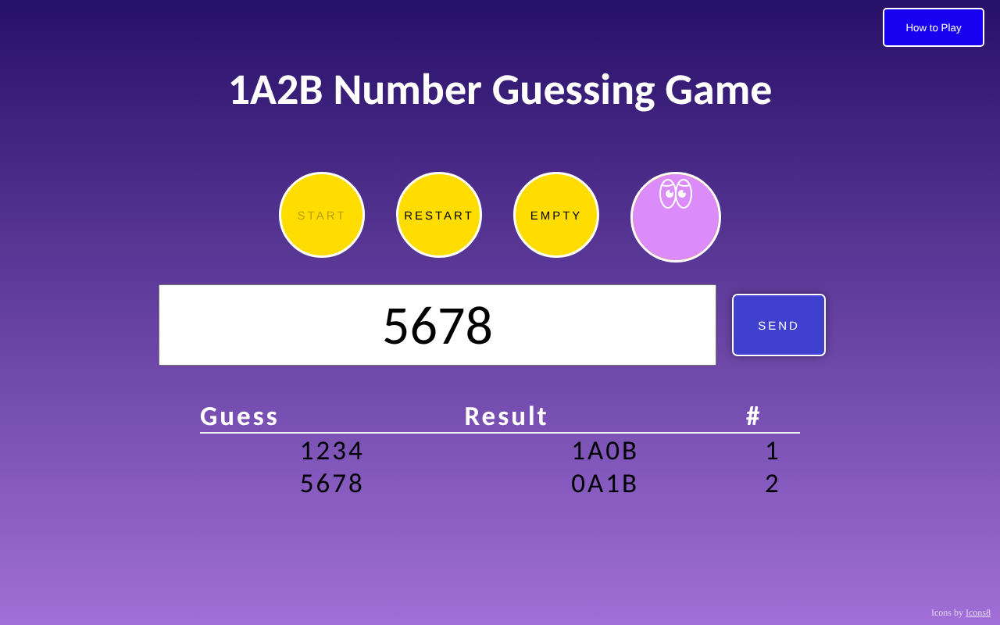

# Web Projects (2024)

Two small browser games I built in early 2024 during my software engineering internship at MAYOHR in Taiwan. Both use plain HTML, CSS and JavaScript with no frameworks or libraries.

| Project | Play | Code |
|---|---|---|
| Sliding Puzzle | [Play in browser](https://yusun1218.github.io/web-projects-2024/puzzle/) | [`puzzle/`](puzzle/) |
| 1A2B Number Guessing Game | [Play in browser](https://yusun1218.github.io/web-projects-2024/1a2b/) | [`1a2b/`](1a2b/) |

## Sliding Puzzle

The classic sliding tile puzzle. Pick a level (3x3, 4x4 or 5x5), press Start, and click tiles next to the empty space to slide them. The reference image on the right shows what the finished picture should look like. You can also upload your own photo and play with that instead.

How it works:

- The picture is never actually cut up. Every tile uses the same image as its background, and `background-position` shifts it so each tile shows a different part.
- The board is a CSS grid, and the number of columns changes with the level.
- The tile order is kept in an array. Moving a tile swaps two values in the array and redraws the board.
- Uploaded photos are read with `FileReader` and used as the new puzzle image.
- A random shuffle can produce a board that can't be solved, so the shuffle repeats until the inversion count says the board is solvable.

**A bug I fixed later:** in 2026 I tested the game again and noticed some boards could never be finished. The solvability check treated tile `0` as the empty space, but in my game the empty space is the last tile. That made the check wrong about half the time. I rewrote the check to use the correct tile and to handle the different rule for 4x4 boards, then tested it against thousands of shuffled boards.

The puzzle image is an original illustration made for this project.

## 1A2B Number Guessing Game

The game picks a secret 4-digit number with no repeated digits. You guess, and it tells you how close you are: **A** means a right digit in the right place, **B** means a right digit in the wrong place. `4A0B` wins.

Features:

- Input checks: the guess must be 4 digits, can't repeat a digit, and can't be a number you've already tried.
- A table keeps every guess with its result.
- Clicking the eyes button flips it over to show the answer, and clicking again hides it (handy for testing, or for giving up).
- Rules pop up in a window, and Enter submits a guess.

Icons by [Icons8](https://icons8.com).

## Running locally

No build step. Download the repo and open `puzzle/index.html` or `1a2b/index.html` in any browser.
